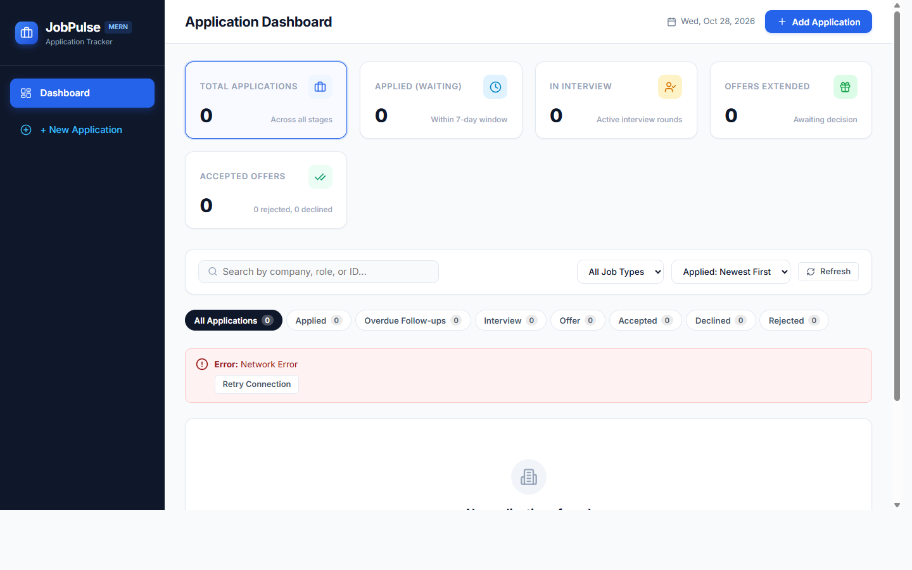
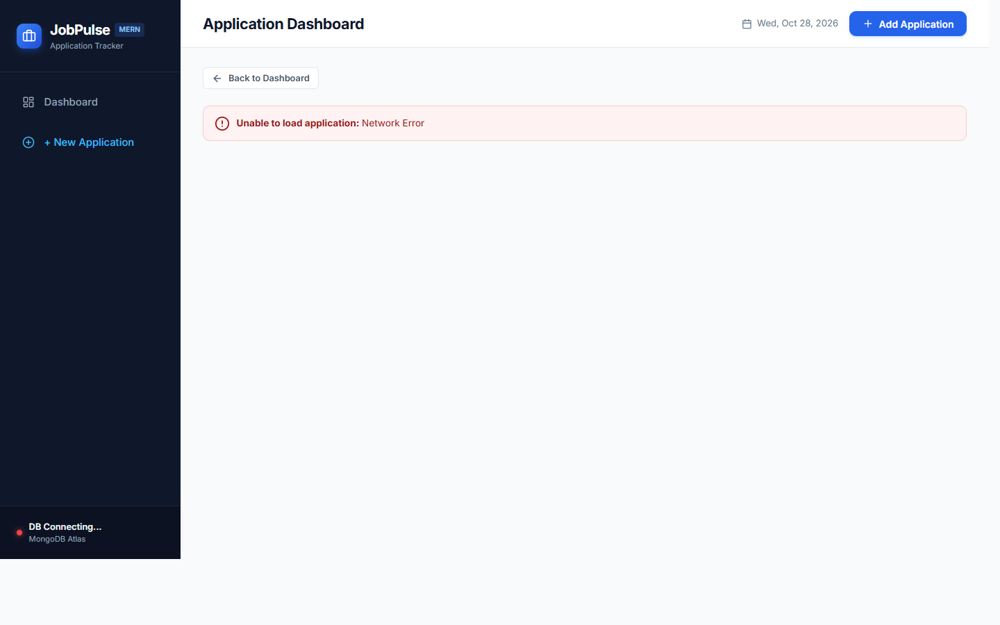

# 🎯 Job Application Tracker (MERN Stack)

A production-ready, full-stack Job Application Tracker built with the **MERN** stack (MongoDB, Express.js, React, Node.js) for candidate evaluation. It features concurrency-safe custom ID generation, strict status state machine enforcement, follow-up deadline tracking, duplicate prevention, and a responsive modern dashboard with an interactive status timeline.

---

## 📸 Application Screenshots

### 1. Dashboard View
> *Overview of all applications, summary stat cards, overdue follow-up alerts, search bar, and status filter pills.*



### 2. Application Details & Status Timeline
> *Deep-dive view into an individual application showing job metadata, salary, follow-up window, and chronological status transition history.*



---

## 🛠 Tech Stack

- **Frontend:** React 18, Vite 6, React Router DOM 6, Axios, Lucide React icons, and modern responsive CSS with CSS variables.
- **Backend:** Node.js 20, Express.js 4, Mongoose 8, CORS, Morgan logger, Dotenv.
- **Database:** MongoDB Atlas (with seamless zero-setup in-memory fallback for immediate automated testing and assessment evaluation).
- **Architecture:** Decoupled `frontend/` and `backend/` in a single monorepo structure with root orchestration scripts.

---

## ⚙️ Business Rules & Implementation Details

| Business Rule | Description & Behavior |
| :--- | :--- |
| **Concurrency-Safe Application ID** | Generated **strictly on the server** in the format `JA-[PREFIX]-[SEQ]` (e.g. `JA-INF-001`, `JA-GOO-002`). Uses the first 3 letters of the uppercase sanitized company name (padded with 'X' if < 3 letters). Increments an atomic counter (`Counter.findByIdAndUpdate` with `$inc`) separately for each company. |
| **Default Initial Status** | Every new application automatically begins with status `Applied`. Initial status history entry is created with the application submission timestamp. |
| **Status State Machine** | Only strictly defined transitions are allowed:<br>&bull; `Applied` &rarr; `Interview` or `Rejected`<br>&bull; `Interview` &rarr; `Offer` or `Rejected`<br>&bull; `Offer` &rarr; `Accepted` or `Declined`<br>&bull; `Rejected`, `Accepted`, `Declined` are **final statuses** (no transitions allowed). |
| **Transition Rejections** | Invalid transitions (e.g. `Applied` &rarr; `Offer` or modifying a final status) are rejected with **HTTP 400** and a meaningful error payload showing allowed transitions. Only permitted next transitions are surfaced to the frontend. |
| **Status History Timeline** | Every status update creates an immutable audit trail entry containing `status`, `changedAt` (ISO timestamp), and optional transition `notes`. |
| **Follow-up Date & Overdue Calculation** | Target follow-up date is automatically calculated as `appliedDate + 7 calendar days`. If the application remains in `Applied` status past this date, `isOverdue: true` is dynamically returned and a red pulsing warning badge is displayed in the UI. |
| **Duplicate Active Application Prevention** | Duplicate applications for the **same company and job role** are prohibited (comparing case-insensitive and whitespace-trimmed strings). Returns **HTTP 409 Conflict** with an informative message. Applications in final statuses (`Rejected`, `Accepted`, `Declined`) **do not block** subsequent new applications. |
| **Field Editing Protections** | Users may edit `company`, `role`, `jobType`, `expectedSalary`, and `notes`. Editing `applicationId` or `appliedDate` after creation is strictly forbidden (rejected with **HTTP 400**). |
| **Deletion Rules** | Deletion is permitted **only** when status is `Applied` or a final status (`Rejected`, `Accepted`, `Declined`). Deleting applications in active pipeline stages (`Interview` or `Offer`) is **blocked on both backend and frontend** (HTTP 400 with explicit confirmation required). |
| **Consistent API Responses** | All API endpoints return a standardized JSON structure: `{ success: boolean, message: string, data: any }`. Proper HTTP status codes (200, 201, 400, 404, 409, 500) are utilized throughout. |

---

## 📁 Project Structure

```
mernexm/
├── backend/
│   ├── src/
│   │   ├── config/
│   │   │   └── db.js                 # MongoDB connection & health check
│   │   ├── controllers/
│   │   │   └── applicationController.js # Core business logic & CRUD handlers
│   │   ├── middleware/
│   │   │   └── errorHandler.js       # Centralized error & 404 middleware
│   │   ├── models/
│   │   │   ├── Application.js        # Mongoose schema, validation & virtuals
│   │   │   └── Counter.js            # Atomic sequence counters
│   │   ├── routes/
│   │   │   ├── applicationRoutes.js  # REST routes
│   │   │   └── healthRoutes.js       # Health check route
│   │   ├── utils/
│   │   │   ├── idGenerator.js        # Concurrency-safe ID generator
│   │   │   └── statusRules.js        # State transition validation helpers
│   │   └── server.js                 # Express server bootstrap
│   ├── scripts/
│   │   └── seed.js                   # Realistic demo data seed script
│   ├── tests/
│   │   └── api.test.js               # 16 automated integration tests
│   ├── .env.example
│   ├── .env                          # Configured environment variables
│   └── package.json
├── frontend/
│   ├── src/
│   │   ├── components/
│   │   │   ├── ApplicationFormModal.jsx # Add & Edit modals with client validation
│   │   │   ├── ApplicationTable.jsx     # Responsive table with action buttons
│   │   │   ├── ConfirmationModal.jsx    # Deletion confirmation dialog
│   │   │   ├── Navbar.jsx               # Top navigation bar
│   │   │   ├── Sidebar.jsx              # Side drawer with DB status indicator
│   │   │   ├── StatusBadge.jsx          # Color-coded badges & overdue pulse
│   │   │   ├── StatusChangeModal.jsx    # Permitted status transition dialog
│   │   │   ├── SummaryCards.jsx         # Metric summary cards
│   │   │   └── Toast.jsx                # Toast notification system
│   │   ├── pages/
│   │   │   ├── Dashboard.jsx            # Main dashboard & filters
│   │   │   └── ApplicationDetails.jsx   # Details page & timeline view
│   │   ├── services/
│   │   │   └── api.js                   # Axios client configuration
│   │   ├── styles/
│   │   │   └── index.css                # Polished design system
│   │   ├── App.jsx
│   │   └── main.jsx
│   ├── .env.example
│   ├── .env
│   ├── vite.config.js
│   └── package.json
├── screenshots/
│   ├── dashboard.png
│   └── application-details.png
├── .gitignore
├── package.json                      # Monorepo runner scripts
└── README.md
```

---

## 🚀 Installation & Getting Started

### Prerequisites
- Node.js (v18.x, v20.x or higher)
- npm (v9.x or higher)
- MongoDB Atlas cluster URI (optional — if omitted or offline, the server automatically starts an in-memory MongoDB instance for seamless local testing)

---

### Step 1: Clone and Install Dependencies
From the repository root:
```bash
# Install backend and frontend dependencies
npm run install:all
```
*(Or navigate to `backend` and `frontend` separately and run `npm install`).*

---

### Step 2: Environment Configuration

#### Backend (`backend/.env`):
A ready-to-run `.env` file is already provided. To connect to your MongoDB Atlas cluster, update `backend/.env`:
```env
PORT=5000
MONGODB_URI=mongodb+srv://<username>:<password>@cluster0.mongodb.net/job_tracker_db?retryWrites=true&w=majority
NODE_ENV=development
CLIENT_URL=http://localhost:5173
```

#### Frontend (`frontend/.env`):
```env
VITE_API_URL=http://localhost:5000/api
```

---

### Step 3: Run the Automated Test Suite
Verify that all 16 business rules, API constraints, and validation logic pass:
```bash
npm run test
```
**Test Coverage Includes:**
- Custom `JA-INF-001` ID generation and per-company sequence isolation
- HTTP 409 rejection of duplicate active applications (case & whitespace insensitive)
- Rejection of future applied dates (HTTP 400)
- Overdue calculation (Applied + 7 days)
- State machine transitions (`Applied` &rarr; `Interview` &rarr; `Offer` &rarr; `Accepted`)
- Rejection of illegal transitions (e.g. `Interview` &rarr; `Accepted` or from `Accepted`)
- Re-application allowed after reaching final status
- Protection against editing `applicationId` or `appliedDate`
- Blocking deletion in `Interview` or `Offer` stages (HTTP 400)
- Permission of deletion in `Applied` and final statuses

---

### Step 4: Seed Demo Data
Populate realistic sample job applications across all stages:
```bash
npm run seed
```

---

### Step 5: Start the Development Servers

Open two terminal tabs:

**Terminal 1 — Backend:**
```bash
npm run server
```
*API will start on `http://localhost:5000`.*

**Terminal 2 — Frontend:**
```bash
npm run client
```
*Vite UI will open on `http://localhost:5173`.*

---

## 📡 REST API Reference

All responses follow the envelope format:
```json
{
  "success": true,
  "message": "Operation description",
  "data": { ... }
}
```

### Endpoints Summary

| Method | Endpoint | Description | Status Codes |
| :--- | :--- | :--- | :--- |
| `GET` | `/api/health` | MongoDB connection status and server health | 200, 503 |
| `GET` | `/api/applications` | List applications with query search & status filtering | 200 |
| `POST` | `/api/applications` | Create new application (generates custom ID) | 201, 400, 409 |
| `GET` | `/api/applications/:id` | Fetch single application by MongoDB `_id` or `applicationId` | 200, 404 |
| `PUT` | `/api/applications/:id` | Update editable fields (`company`, `role`, `jobType`, `salary`, `notes`) | 200, 400, 404, 409 |
| `PATCH` | `/api/applications/:id/status` | Transition status with state machine validation | 200, 400, 404 |
| `DELETE` | `/api/applications/:id` | Delete application (only allowed in Applied or final status) | 200, 400, 404 |
| `GET` | `/api/applications/stats` | Status count breakdown (Total, Applied, Interview, Offer, Overdue, etc.) | 200 |

---

### Sample Requests & Responses

#### 1. Create Application
**`POST /api/applications`**
```json
{
  "company": "Infosys",
  "role": "Full Stack Developer",
  "jobType": "Full-time",
  "appliedDate": "2026-10-25",
  "expectedSalary": 90000,
  "notes": "Applied via referral"
}
```
**Response (201 Created):**
```json
{
  "success": true,
  "message": "Application created successfully.",
  "data": {
    "applicationId": "JA-INF-001",
    "company": "Infosys",
    "role": "Full Stack Developer",
    "jobType": "Full-time",
    "appliedDate": "2026-10-25T00:00:00.000Z",
    "expectedSalary": 90000,
    "status": "Applied",
    "followUpDate": "2026-11-01T00:00:00.000Z",
    "isOverdue": false,
    "statusHistory": [
      {
        "status": "Applied",
        "changedAt": "2026-10-25T00:00:00.000Z",
        "notes": "Application created"
      }
    ]
  }
}
```

#### 2. Duplicate Active Application Conflict
**`POST /api/applications`** (Same company and role, different casing)
```json
{
  "company": "  infosys  ",
  "role": "full stack developer ",
  "appliedDate": "2026-10-28"
}
```
**Response (409 Conflict):**
```json
{
  "success": false,
  "message": "An active application for \"full stack developer\" at \"infosys\" already exists (ID: JA-INF-001, Status: Applied). Finalize that application first.",
  "data": null
}
```

#### 3. Change Status
**`PATCH /api/applications/JA-INF-001/status`**
```json
{
  "status": "Interview",
  "notes": "Cleared technical screening"
}
```
**Response (200 OK):**
```json
{
  "success": true,
  "message": "Status successfully updated to Interview.",
  "data": {
    "applicationId": "JA-INF-001",
    "status": "Interview",
    "validNextStatuses": ["Offer", "Rejected"]
  }
}
```

#### 4. Attempting Invalid Status Transition
**`PATCH /api/applications/JA-INF-001/status`** (Attempting to jump from `Interview` to `Accepted`)
```json
{
  "status": "Accepted"
}
```
**Response (400 Bad Request):**
```json
{
  "success": false,
  "message": "Invalid status change: Cannot transition from \"Interview\" to \"Accepted\". Allowed next transitions: [Offer, Rejected].",
  "data": {
    "currentStatus": "Interview",
    "validNextStatuses": ["Offer", "Rejected"]
  }
}
```

#### 5. Attempting to Delete in Interview Stage
**`DELETE /api/applications/JA-INF-001`**
**Response (400 Bad Request):**
```json
{
  "success": false,
  "message": "Deletion forbidden: Applications in \"Interview\" status cannot be deleted. Deletion is permitted only when status is \"Applied\" or a final status (\"Rejected\", \"Accepted\", \"Declined\").",
  "data": null
}
```

---

## 📋 GitHub Submission Checklist

- [x] Separate `frontend/` and `backend/` folders in one root project.
- [x] Node.js, Express, MongoDB Atlas, and Mongoose for backend.
- [x] React with Vite, React Router, Axios, and modern CSS for frontend.
- [x] Custom Application ID format `JA-INF-001` generated only on backend with concurrency-safe sequence.
- [x] Strict state machine status transitions enforced on backend and frontend.
- [x] Status history audit timeline on details page with date and time.
- [x] Follow-up date (`appliedDate + 7 days`) and `isOverdue` calculation with alert pill.
- [x] Duplicate active application prevention with HTTP 409 conflict and UI error message.
- [x] Editing locked fields (`applicationId`, `appliedDate`) prevented.
- [x] Deletion restrictions: forbidden in `Interview` and `Offer`, permitted in `Applied` or final statuses.
- [x] Search, status filter, and all-status count cards.
- [x] Standardized API JSON responses `{ success, message, data }` with proper HTTP codes.
- [x] Centralized error-handling middleware and `/api/health` MongoDB health check.
- [x] `.env.example` files provided for both backend and frontend.
- [x] Complete `package.json` files with all required dependencies.
- [x] Comprehensive automated test suite (`npm run test`) passing 16 tests.
- [x] Seed script (`npm run seed`) for realistic demo data.
- [x] Two application screenshots included in `screenshots/` and embedded in `README.md`.
- [x] Clean `.gitignore` ignoring `node_modules`, builds, and secrets.
